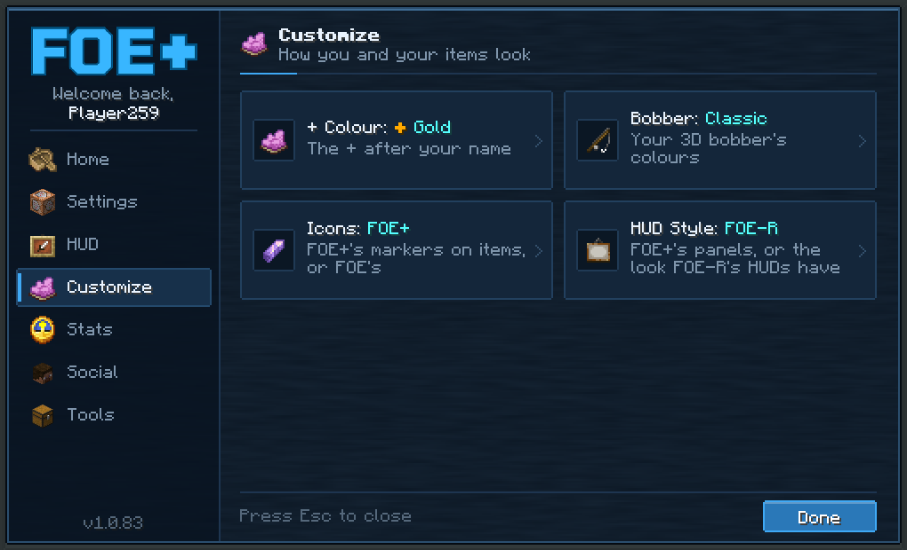
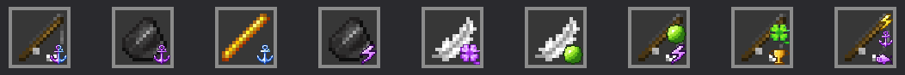
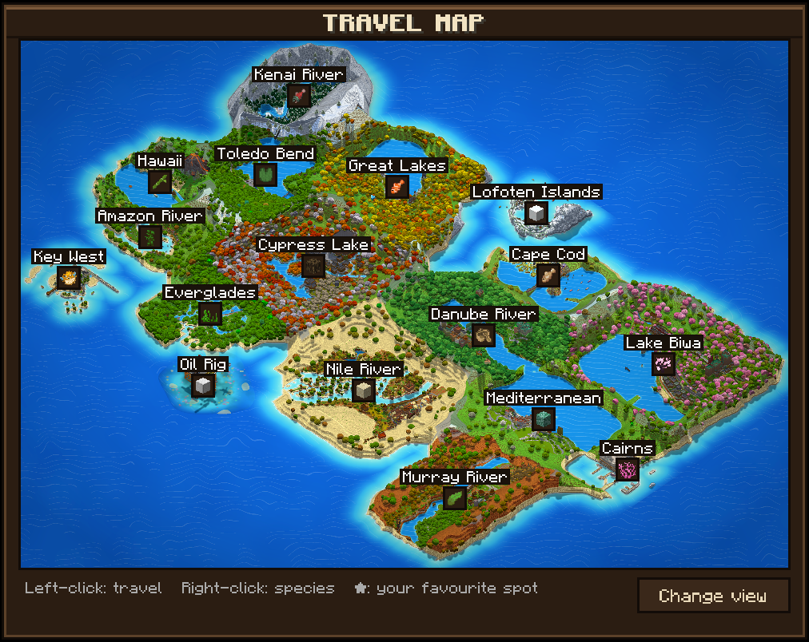
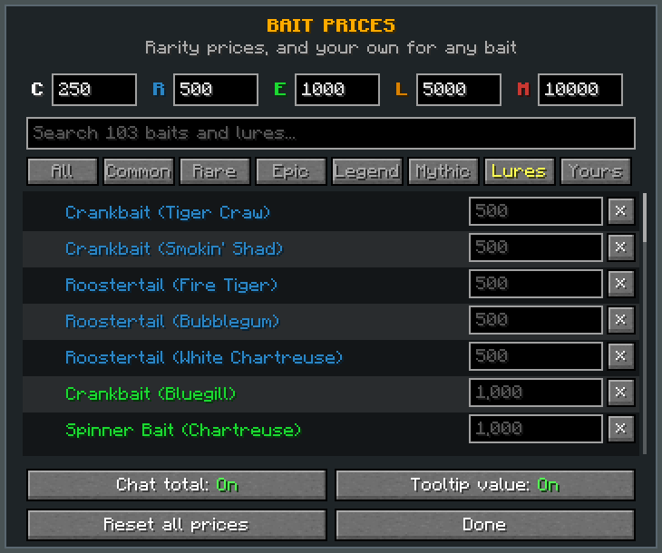

# FOE+ Features

Everything FOE+ adds to **play.fishonmc.net**. Press **O** in game to open the FOE+ menu, where every feature can be turned on, off or moved.

<p align="center">
  
</p>

**Contents:** [HUD panels](#hud-panels) · [HUD Editor](#hud-editor) · [Alerts](#alerts) · [Chat notifications](#chat-notifications) · [Pets](#pets) · [Rod parts](#rod-parts) · [Dry streaks & stats](#dry-streaks--stats) · [Contests](#contests) · [Travel map](#travel-map) · [Fishing presets](#fishing-presets) · [Personal Vault & bait](#personal-vault--bait) · [Tools](#tools) · [Keybinds](#keybinds) · [From FOE-R](#from-foe-r)

---

## HUD panels

Every panel can be moved, anchored to any corner or edge, and resized in **O → Move HUD Elements**.
Panels stay exactly where you put them (only kept on screen), and can overlap if you place them that way. A panel whose text changes width, like a countdown, doesn't jump sideways.

<p align="center"></p>

| Panel | What it shows |
|---|---|
| **Contest** | Time left, contest type, the fish you need (Fish: in its rarity colour), the best baits (as pictures or by name; with only the best one shown, hover it with chat open for the rest), the top 3 and your rank. Warns you when you're not in the contest area. |
| **Daily Quests** | Exact progress on each daily quest, updated after every catch. Quests you can do anywhere say "Anywhere"; number each mission (#1, #2...) if you like. |
| **Quests** | Your active location quests. |
| **All-Time Stats** | Total Caught (with the share of your catches that were fish), fish per hour, fish time (the server's "Time Fishing" from your /menu profile, read on each login and counted up from there) and quests; Total Pets, Shards, Infusion Capsules and Lightning Bottles with their dry streaks; then rarities, variants and Gigantic. |
| **Luck & Scale** | Your real Luck and Scale, read from your `/menu` profile so boosters count, with a live countdown while a global Luck or Scale booster is on. Refreshes automatically when you change location. A green clover for Luck is a setting. |
| **Events** | An active Fish Frenzy (where, and how long is left of its hour), a Blooming Oasis (♣) and a Gold Rush (⚠, shards 1 in 25), each about 15 minutes while its symbol is on the boss bar, and an active Fabled event (until it's caught). Kept in sync with `/events`, which FOE+ checks quietly every 15 minutes.  Weather shows here too: rain showers, thunderstorms and supercells (one at a time, wherever you are) and moons, with how long they have left once FOE+ has seen one end. Global Money and XP boosters show here too, counting down; Luck and Scale boosters show next to their numbers on Luck & Scale. FOE+ checks /active quietly a few seconds after you join, every 15 minutes, after a booster's chat line and when a booster ends so boosters popped before you logged in show as well. |
| **Mini Event** | The mini event from /minievent: when the daily missions reroll ("Rerolls 23h 55m 2s") and every mission with its progress, in the server's colours (GIGANTIC as a badge). Missions go up as you catch, like Daily Quests, only when the catch matches everything the mission names (place, GIGANTIC and the other sizes, ALBINO and the other variants, rarity, fish); a finished one shows its ✔ for a few seconds and then leaves until the daily reroll (repeatable ones stay). FOE+ checks /minievent quietly every 10 minutes, about a minute after catches and right after the reroll, hiding its answer. Hidden when no mini event is on; can be set to show only while you're at the event's location. |
| **Session Stats** | Everything All-Time Stats shows, for this session only: fish caught, fish/hour and fish time, quests, pets, shards, capsules, bottles, each rarity, gigantic and each variant, with shares and fish since the last one this session. Counted from your catches and cleared when you log out. Can be turned off. |
| **Pet** | Your equipped pet (framed in its rarity colour), its level and XP bar (the game's look, or FOE+'s filled bars), its rating, the item it's holding, and **Max Luck** / **Max Scale** / **Max** when its rolls here are as good as they get (green clover by default). |
| **Bait** | The bait on your rod and how many you have left. |
| **Alerts** | Active and upcoming cryptid windows with live timers. |
| **Warning** | Wrong pet for this location (names the right one), wrong armor climate, a saltwater rod at a freshwater place (or the other way round), or a nearly full inventory. Not shown at Cypress Lake's spawn until you reach the water. Its text is centred and it stays where you put it. |
| **Top bar** | Your name and level (in the exact colours chat gives it, animated ones too), level progress, location in the travel menu's colours, the spot you're at (Big Bear Dock, Thunderwood Marina...), catch range, weather, the in-game time (ticking minute by minute), balance, credits, catches and catch rate, the server's TPS and your ping, plus the community event total and your contribution. Every part can be turned off in **HUD settings → Top bar**. Fits any screen size. |
| **Timers** | Next to your inventory and as a HUD panel: next moon, Tackle Shop restock (every 4 hours, ✔ once you've checked it), Cosmetic Store reset (7pm EST), your votes (x/7 in the last 24 hours), and the community goal under a line: how far along it is, catches per hour and when it'll be reached. |
| **Social** | Whether a crew member is in range, then your crew and friends, online first, with the instance each is on ("InfernalShadow (i5)", from a quiet /find). In the inventory a **+** adds a friend and the list scrolls. |
| **Equipment bar** | Armor, rod parts and bait at a glance. |
| **Catch popup** | Big popup for the fish you just caught. |
| **Catch ring** | While you reel a fish in, a ring round the crosshair fills clockwise in green, and flashes full when it's caught. Move and size it like a panel. |

The default FOE-R HUDs start hidden so the screen isn't cluttered. Turn any of them back on in **O → Custom HUDs**. The first time you join with FOE+ the panels start in a tidy layout instead of on top of each other.

---

## HUD Editor

Pick any of FOE+'s panels and change how it looks: line spacing, padding, the box's colour and how see-through it is, the border's and title's colours, text alignment (follow the corner, or always left, centred or right), lines to hide, and your own picture (PNG or GIF, it plays) from `config/fishonmcextras/hud_images/`.

- **HUD style:** FOE+'s panels, or the look FOE-R's HUDs have (a see-through box between dark bars).
- **Item icon style:** FOE+'s rarity dot and rating letter, or FOE's rarity corner, for players coming from FOE.
- Panel frames stay crisp at any size, and small panels never shrink below readable.

---

## Alerts

The Alerts panel and chat tell you when a rare catch is possible and how long the window lasts. The timers count down smoothly.

| Alert | Where | When | Odds |
|---|---|---|---|
| **Witching Hour** (Bigfoot) | Cypress Lake | 1–3 AM in game | 1 in 300 |
| **Titanoboa** (Titan's Fang) | Amazon River | 2–4 AM in game | 1 in 1,500 |
| **Bessie** (Silver Scale) | Great Lakes | 4–6 AM in game | 1 in 1,000 |
| **Bessie**, moon | Great Lakes | During a moon | 1 in 500 |
| **Rougarou** (Blood / Claw) | Toledo Bend | During a moon | 1 in 300 |
| **Garaboncias** (Concoction / Essence) | Danube River | During a rainbow | 1 in 250 |
| **Fabled event** | Announced in chat | Until someone catches it | — |

- **Fabled tracker:** starts when the event appears in chat and ends when the fish is caught, and FOE+ tells you who caught it.
- **Moon timer:** counts down to the next moon on its 2 h 40 min cycle, and re-syncs itself every time a moon starts.
- **Optional:** chat lines, sounds, "only alerts for where I am", and how far ahead to show upcoming windows.

---

## Chat notifications

All FOE+ messages share one clean style, starting with a bold **[FOE+]** tag, with location names in the server's own colours:

```
[FOE+] PET PULLED! Eagle Pet (87.0% A) · Dry streak 164
[FOE+] You caught MELANISTIC 🐟 Largemouth Bass · Dry streak 1,234
[FOE+] You caught GIGANTIC 🐟 Walleye · Dry streak 5,321
[FOE+] RARE CATCH! Infusion Capsule · Dry streak 2,410
[FOE+] RARE CATCH! Lightning in a Bottle · Dry streak 220
[FOE+] WITCHING HOUR Cypress Lake · Bigfoot 1/300 · 2:10 left
[FOE+] FABLED CAUGHT Danube River · by Steve
[FOE+] WRONG PET Eagle Pet · Danube River needs a Wolf Pet (in inventory)
[FOE+] CONTEST New personal best · Rank #4 · 8.0 lb
```

In game, the rarity, variant and Gigantic badges appear in place of the words.

- **Pet pulls:** rarity badge, pet, percentage, rating and your pet dry streak.
- **Variants:** Albino, Melanistic, Trophy and Fabled, with the fish and that variant's dry streak.
- **Gigantic catches:** the Gigantic badge, the fish and its dry streak.
- **Infusion Capsules and Lightning Bottles:** when the server says you pulled one, with its dry streak.
- **Contest chat:** proper spacing, and the hourly auto-refresh output is hidden.
- You can turn each notification on or off in Settings.

---

## Pets

- **Exact pet per location:** FOE+ knows the one pet each location needs.

  | Location | Pet | Location | Pet |
  |---|---|---|---|
  | Cypress Lake | Bullfrog | Oil Rig | Pelican |
  | Kenai River | Bear | Amazon River | Capybara |
  | Lake Biwa | Fox | Mediterranean Sea | Lynx |
  | Murray River | Kangaroo | Cape Cod | Shark |
  | Everglades | Marsh Rabbit | Hawaii | Dolphin |
  | Key West | Sea Turtle | Cairns | Koala |
  | Toledo Bend | Duck | Lofoten Islands | Sheep |
  | Great Lakes | Eagle | Nile River | Hippo |
  | Danube River | Wolf | | |

- **Wrong pet warning:** a warning box plus a chat line when you arrive with the wrong pet, telling you whether the right one is in your inventory.
- **Held item:** the item your pet is holding shows in the Pet panel, and pets holding an amulet get a star on their slot in the amulet's rarity colour.
- **Pet tooltips:** rating letter and max Luck / max Scale markers. A pet wearing a skin gets its tooltip framed in the skin's own colours.
- **Pet drops:** pets from contests and events are told once and never counted in your pet stats.
- **Pet Prices (`U`):** the full price table from the community price sheet, updated once a day.

---

## Rod parts

<p align="center"></p>

- **Calibration icons:** a small icon in the bottom-right corner of a rod part for what it's calibrated for: XP, money, luck, scale, prospect, albino, melanistic, trophy or bite/reel speed.
- **On the rod too:** a rod shows an icon for each stat its line, pole and reel are calibrated for, stacked up the right side.
- **Max rolls in purple:** an icon turns all purple when that stat is rolled at the highest its rarity can roll. On a rod, a stat on two parts with only one of them maxed is half purple, half its own colour.

---

## Dry streaks & stats

- **Live dry streaks** for every rarity, variant, Gigantic, pets, shards, Infusion Capsules and Lightning Bottles, shown on the All-Time Stats panel. Like FOE, the capsule streak only counts Blood Moon catches and the bottle streak only thunderstorm catches, since that's when they drop.
- **Import from old installs:** FOE+ finds previous FOE and FOE-R installs (Prism, Modrinth, CurseForge, `.minecraft` and other profiles) and imports your stats on first launch.
- **Import Dry Streaks:** pulls streaks (including pets, shards, Infusion Capsules and Lightning Bottles) from your newest old FOE or FOE-R install, plus your pet, shard, capsule and bottle totals where they're higher there. A streak you've reset since then is never overwritten by an older, higher one.
- **Edit Dry Streaks:** set any streak by hand (rarities, variants, Gigantic, pets, shards, Infusion Capsules and Lightning Bottles). Manual edits count as newest, so an import won't undo them.
- **Edit All-Time Stats:** fix any total by hand (fish caught, pets, shards, Infusion Capsules, Lightning Bottles, quests, rarities, variants and Gigantic). Dry streaks stay as they are.
- **Import FOE-R stats:** uses another install's stats if it has more fish, after backing yours up.
- **Reset Fish Timer:** start fish per hour from zero (Fish Time follows the server's "Time Fishing").

---

## Contests

- The top 3 always show, plus your own rank and best catch.
- The fish the contest wants is shown in brackets next to the contest type.
- The panel updates as soon as the server posts a new personal best (`CONTESTS » 26.85lb → 27.45lb`).
- It also refreshes when you change area, and tells you when you're outside the contest area.

---

## Travel map

<p align="center"></p>

The server's Locations menu (`/tt`, or the travel NPC) opens as a detailed world map.

- **Every location on the map:** each one sits on its own landmark, with its name in the server's colours. The place you are at has a gold frame.
- **Same clicks as the menu:** hover for the server's own tooltip, left-click to teleport, right-click to view species.
- **Two maps:** **Realistic** (built from the places themselves) or **Fantasy** (the painted map). **Change view** switches between them and the server's plain menu any time; "Back to travel map" above that menu returns. Turn the map off altogether with **O → Travel map**.
- **Favourites:** star one teleport spot in each place.
- **What's on:** a Fabled fish waiting to be caught, a Fish Frenzy and its time left, or the place's own event, right on its place.

## Fishing presets

<p align="center"></p>

The server's Presets menu on one screen, without paging.

- **All ten at once:** presets 1–5 on the left and 6–10 on the right, with **Armor** and **Rods** tabs at the top.
- **Wear a preset:** click its tick. The preset in use shows the star and a gold frame; clicking the star takes it off.
- **Change a piece:** click a piece to send it back to your inventory. To put one in, pick it up from your inventory (which stays below the panel) and click a place in the preset.
- **Tooltips:** hovering a piece shows the server's full tooltip.
- **Three styles:** clean rows, cards with the pieces on a tray, or lighter slots with a round marker, picked from the **Style** menu on the panel.
- **Classic menu:** a small button on the panel switches to the server's plain menu; "FOE+ presets view" above that menu returns. Turn the panel off with **O → Presets screen**.

## Personal Vault & bait

<p align="center"></p>

- **Bait sorter (`B`):** merges and sorts the baits and lures (mythical ones too) in your inventory, chests and vault, by rarity, amount or name. Every copy of a bait on a vault page merges through the one in your inventory and goes back, and twins that are only in the vault are pulled out to merge. It remembers the order you last picked on the vault's sort buttons.
- **Save Layout:** arrange a vault page the way you like and press **Save Layout**: from then on `B` puts every item on that page back in the slot you saved it in, until you use one of the sort buttons. Each page has its own; Shift-click to forget it.
- **Personal Vault:** page buttons 1–7, a **Bait Sorter** box (sort baits by amount, rarity or name; name groups every Crankbait together), an **Armor Sorter** box (by quality, rarity, climate or rolls) and a **Pet Sorter** box (by percent, luck, scale, rarity or name). Everything else stays put, Shift-click reverses, the boxes are on chests too, and locked pages show their rank badge.
- **Bait Prices (Tools → Bait Prices):** what a bait is worth to you: a price for each rarity, and your own price for any single bait. Every bait and lure from the wiki's Tacklebox list is there with its rarity and picture.
- **Bait value:** a baitbox's Package (or any menu with bait) gets a box with what its bait is worth; a bait's Stock line shows the stack's value; and opening a baitbox puts the total in chat.
- **Fish value:** beside a chest, what the fish in it and in your inventory are worth.

## Tools

- **Auto Tip (`M`):** automatically tips reaction winners and chummers, with per-tip amounts, rarity badges and a session total.
- **Inventory search:** the Personal Vault's search bar above your inventory and in chests too; matching items get a red outline (the search help shows only on the vault's bar), and while you type, keys like Q and 1–9 don't drop or swap items.
- **Inspect:** hold Shift to see fish details, pet % and armor rolls, or set Inspect to **Always On**, **Pets Only** or **Armor Only** in the O menu.
- **Friends:** `/foe friend` (or **O → Social → Friends**) opens your friends in one window: add someone by name (online players come up as you type), see each friend's balance and crew on their card, and **Join instance** takes you to theirs. `/foe friend add <name>`, `remove` and `list` work too. Friends show on the Social panel in blue; a friend who is also in your crew is light blue with an orange ★ (the crew colour).
- **Chat tags:** Tab completes the server's chat tags ("[it" → "[item]").
- **Crew and friend alerts:** a chat line when a crew member or friend comes online or goes offline.
- **Dismiss warnings (`-`):** hides the warning box until you move to another location.
- **Bobber timer:** how long your bobber has been out ("12.4s") floating over your own bobber; it hides once a fish is on. On by default (from FOE's bobber tracker).
- **Bobber presets:** 16 colour sets for the 3D bobber (Classic, Cherry, Ocean, Ice, Lime, Emerald, Mint, Gold, Bee, Pumpkin, Lava, Candy, Royal, Galaxy, Midnight, Snow), picked in **O → Bobber**. Other FOE+ users near you see your preset, and you see theirs. Players without FOE+ stay Classic.
- **FOE+ users:** a **+** (with a 1-pixel gap so it never touches) after the name of nearby players who use FOE+, in the colour they pick in the O menu (16 colours). Optionally the FOE+ icon above their heads, and the + in the tab list.
- **Safety net:** if the server changes how something looks, the FOE+ part that reads it is skipped instead of crashing your game.

---

## Keybinds

| Key | Action |
|---|---|
| `O` | Open the FOE+ menu |
| `M` | Auto Tip |
| `U` | Pet Prices |
| `B` | Sort baits |
| `-` | Dismiss the warning box at this location |
| *(not set)* | Open the Presets menu |
| *(not set)* | Open the Quests menu |
| `Left Shift` | Inspect (hold) |

All keys can be changed in **O → Settings**.

---

## From FOE-R

FOE+ keeps everything from FishonMC-Extras-R. Find it under **O → More (FOE-R)**:

- Profile, location and notifier HUDs (caught fish and items, completed quests, full inventory)
- Sidebar quests and the hotbar HUD (armor, rod parts, bait)
- Rarity markers on items and a smaller stack counter (it also counts baits)
- A full real-time stats tracker that can import from your server profile
- A 3D fish bobber model
- Triggers, timers, notifications and chat snippets

---

<sub>FOE+ is built on [FishonMC-Extras-R](https://github.com/FishOnExtras/FishonMC-Extras-R), with features from [FOECollab](https://github.com/Kimberlyow/FOECollab) and [FishOnAutotip](https://github.com/Kimberlyow/FishOnAutotip). Licensed under the AGPL-3.0. Not affiliated with Mojang, Microsoft or the FishOnMC server.</sub>
