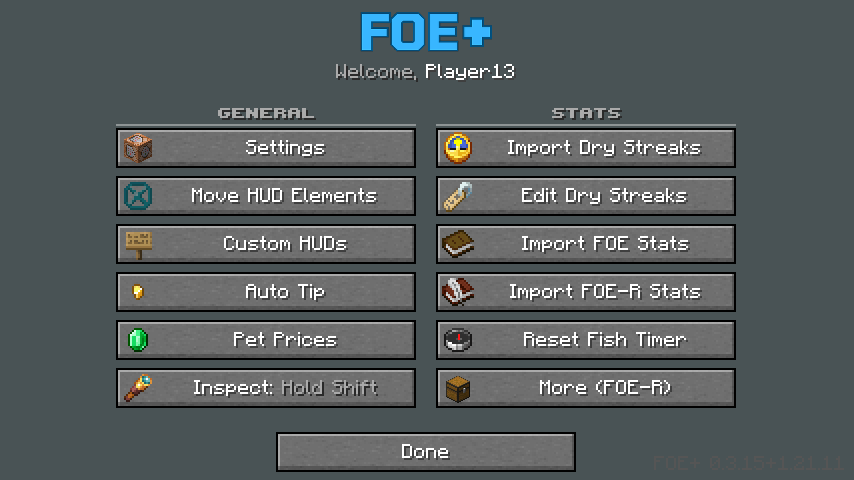

# FOE+ Features

Everything FOE+ adds to **play.fishonmc.net**. Press **O** in game to open the FOE+ menu, where every feature can be turned on, off or moved.

<p align="center">
  
</p>

**Contents:** [HUD panels](#hud-panels) · [Alerts](#alerts) · [Chat notifications](#chat-notifications) · [Pets](#pets) · [Dry streaks & stats](#dry-streaks--stats) · [Contests](#contests) · [Tools](#tools) · [Keybinds](#keybinds) · [From FOE-R](#from-foe-r)

---

## HUD panels

Every panel can be moved, anchored to any corner or edge, and resized in **O → Move HUD Elements**.
Panels always stay on screen, and they push each other aside so they never overlap, at any window size or GUI scale.

| Panel | What it shows |
|---|---|
| **Contest** | Time left, contest type with the fish you need in brackets, best bait, the top 3 and your rank. Warns you when you're not in the contest area. |
| **Daily Quests** | Exact progress on each daily quest, updated after every catch. |
| **Quests** | Your active location quests. |
| **All-Time Stats** | Fish caught, fish per hour, fish time, rarities, variants, Gigantic and Infusion Capsules, each with its dry streak. |
| **Luck & Scale** | Your real Luck and Scale, read from your `/menu` profile so boosters count. Refreshes automatically when you change location. |
| **Pet** | Your equipped pet and the item it's holding. |
| **Bait** | The bait on your rod and how many you have left. |
| **Alerts** | Active and upcoming cryptid windows with live timers. |
| **Warning** | Wrong pet for this location (names the right one), wrong armor climate, or a nearly full inventory. Its text is centred and it stays where you put it. |
| **Top bar** | Level, location, time, balance and catches, plus the community event total and your contribution. |
| **Equipment bar** | Armor, rod parts and bait at a glance. |
| **Catch popup** | Big popup for the fish you just caught. |

The default FOE-R HUDs start hidden so the screen isn't cluttered. Turn any of them back on in **O → Custom HUDs**.

---

## Alerts

The Alerts panel and chat tell you when a rare catch is possible and how long the window lasts. The timers count down smoothly.

| Alert | Where | When | Odds |
|---|---|---|---|
| **Witching Hour** (Bigfoot) | Cypress Lake | 12–3 AM in game | 1 in 300 |
| **Titanoboa** (Titan's Fang) | Amazon River | 2–4 AM in game | 1 in 1,500 |
| **Bessie** (Silver Scale) | Great Lakes | 4–6 AM in game | 1 in 1,000 |
| **Bessie**, moon | Great Lakes | During a moon | 1 in 500 |
| **Rougarou** (Blood / Claw) | Toledo Bend | During a moon | 1 in 300 |
| **Garaboncias** (Concoction / Essence) | Danube River | During a rainbow | 1 in 250 |
| **Fabled event** | Announced in chat | Until someone catches it | — |

- **Fabled tracker:** starts when the event appears in chat and ends when the fish is caught, and FOE+ tells you who caught it.
- **Moon timer:** counts down to the next moon on its 2 h 40 min cycle, and re-syncs itself every time a moon starts.
- **Optional:** chat lines, sounds, "only alerts for where I am", and how far ahead to show upcoming windows.

---

## Chat notifications

All FOE+ messages share one clean style, starting with a bold **[FOE+]** tag:

```
[FOE+] PET PULLED! Eagle Pet (87.0% A) · Dry streak 164
[FOE+] You caught MELANISTIC 🐟 Largemouth Bass · Dry streak 1,234
[FOE+] You caught GIGANTIC 🐟 Walleye · Dry streak 5,321
[FOE+] RARE CATCH! Infusion Capsule · Dry streak 2,410
[FOE+] WITCHING HOUR Cypress Lake · Bigfoot 1/300 · 2:10 left
[FOE+] FABLED CAUGHT Danube River · by Steve
[FOE+] WRONG PET Eagle Pet · Danube River needs a Wolf Pet (in inventory)
[FOE+] CONTEST New personal best · Rank #4 · 8.0 lb
```

In game, the rarity, variant and Gigantic badges appear in place of the words.

- **Pet pulls:** rarity badge, pet, percentage, rating and your pet dry streak.
- **Variants:** Albino, Melanistic, Trophy and Fabled, with the fish and that variant's dry streak.
- **Gigantic catches:** the Gigantic badge, the fish and its dry streak.
- **Infusion Capsules:** when the server says you pulled one, with your capsule dry streak.
- **Contest chat:** proper spacing, and the hourly auto-refresh output is hidden.
- You can turn each notification on or off in Settings.

---

## Pets

- **Exact pet per location:** FOE+ knows the one pet each location needs.

  | Location | Pet | Location | Pet |
  |---|---|---|---|
  | Cypress Lake | Bullfrog | Oil Rig | Pelican |
  | Kenai River | Bear | Amazon River | Capybara |
  | Lake Biwa | Fox | Mediterranean Sea | Lynx |
  | Murray River | Kangaroo | Cape Cod | Shark |
  | Everglades | Marsh Rabbit | Hawaii | Dolphin |
  | Key West | Sea Turtle | Cairns | Koala |
  | Toledo Bend | Duck | Lofoten Islands | Sheep |
  | Great Lakes | Eagle | Nile River | Hippo |
  | Danube River | Wolf | | |

- **Wrong pet warning:** a warning box plus a chat line when you arrive with the wrong pet, telling you whether the right one is in your inventory.
- **Held item:** the item your pet is holding shows in the Pet panel.
- **Pet tooltips:** rating letter and max Luck / max Scale markers.
- **Pet Prices (`U`):** the full price table from the community price sheet, updated once a day.

---

## Dry streaks & stats

- **Live dry streaks** for every rarity, variant, Gigantic and Infusion Capsule, shown on the All-Time Stats panel.
- **Import from old installs:** FOE+ finds previous FOE and FOE-R installs (Prism, Modrinth, CurseForge, `.minecraft` and other profiles) and imports your stats on first launch.
- **Import Dry Streaks:** pulls streaks from your newest old FOE or FOE-R install. A streak you've reset since then is never overwritten by an older, higher one.
- **Edit Dry Streaks:** set any streak by hand (rarities, variants, Gigantic and Infusion Capsules). Manual edits count as newest, so an import won't undo them.
- **Import FOE-R stats:** uses another install's stats if it has more fish, after backing yours up.
- **Reset Fish Timer:** start fish time and fish per hour from zero.

---

## Contests

- The top 3 always show, plus your own rank and best catch.
- The fish the contest wants is shown in brackets next to the contest type.
- The panel updates as soon as the server posts a new personal best (`CONTESTS » 26.85lb → 27.45lb`).
- It also refreshes when you change area, and tells you when you're outside the contest area.

---

## Tools

- **Auto Tip (`M`):** automatically tips reaction winners and chummers, with per-tip amounts, rarity badges and a session total.
- **Bait sorter (`B`):** merges and sorts the baits in your inventory, chests and vault, by rarity or by amount. It remembers the order you last picked on the vault's sort buttons.
- **Personal Vault:** page buttons 1–7, sorting by amount or rarity (Shift-click to reverse), and rank badges on locked pages.
- **Inspect:** hold Shift to see fish details, pet % and armor rolls, or set Inspect to **Always On** in the O menu.
- **Dismiss warnings (`-`):** hides the warning box until you move to another location.
- **Bobber presets:** nine colour sets for the 3D bobber (Classic, Ocean, Lime, Gold, Pumpkin, Candy, Royal, Midnight, Glass). Cycle them with the **Bobber** button in the O menu. Your bobber uses your preset and other players' stay Classic, so yours is easy to spot (or show yours on everyone's in Settings).
- **FOE+ users:** a **+** after the name of nearby players who use FOE+, in the colour they pick in the O menu (16 colours).

---

## Keybinds

| Key | Action |
|---|---|
| `O` | Open the FOE+ menu |
| `M` | Auto Tip |
| `U` | Pet Prices |
| `B` | Sort baits |
| `-` | Dismiss the warning box at this location |
| `Left Shift` | Inspect (hold) |

All keys can be changed in **O → Settings**.

---

## From FOE-R

FOE+ keeps everything from FishonMC-Extras-R. Find it under **O → More (FOE-R)**:

- Profile, location and notifier HUDs (caught fish and items, completed quests, full inventory)
- Sidebar quests and the hotbar HUD (armor, rod parts, bait)
- Rarity markers on items and a smaller stack counter (it also counts baits)
- A full real-time stats tracker that can import from your server profile
- A 3D fish bobber model
- Triggers, timers, notifications and chat snippets

---

<sub>FOE+ is built on [FishonMC-Extras-R](https://github.com/FishOnExtras/FishonMC-Extras-R), with features from [FOECollab](https://github.com/Kimberlyow/FOECollab) and [FishOnAutotip](https://github.com/Kimberlyow/FishOnAutotip). Licensed under the AGPL-3.0. Not affiliated with Mojang, Microsoft or the FishOnMC server.</sub>
