# FOE+ Features

Everything FOE+ adds to **play.fishonmc.net**. Press **O** in game to open the FOE+ menu, where every feature can be turned on, off or moved.

<p align="center">
  
</p>

**Contents:** [HUD panels](#hud-panels) · [Settings](#settings) · [HUD Editor](#hud-editor) · [Alerts](#alerts) · [Chat notifications](#chat-notifications) · [Pets](#pets) · [Pet Prices](#pet-prices) · [Rod parts](#rod-parts) · [Dry streaks & stats](#dry-streaks--stats) · [Contests](#contests) · [Travel map](#travel-map) · [Fishing presets](#fishing-presets) · [Personal Vault & bait](#personal-vault--bait) · [Tools](#tools) · [Sounds](#sounds) · [Keybinds](#keybinds) · [From FOE-R](#from-foe-r)

---

## HUD panels

Every panel can be moved, anchored to any corner or edge, resized (down to half size) and turned off in **O → Move HUD Elements**.
Panels stay exactly where you put them (only kept on screen), and can overlap if you place them that way. A panel whose text changes width, like a countdown, doesn't jump sideways.

<p align="center">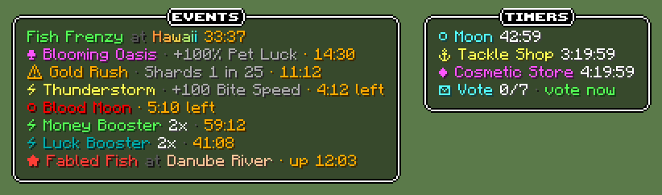</p>

| Panel | What it shows |
|---|---|
| **Contest** | Time left, contest type, the fish you need (Fish: in its rarity colour), the best baits (as pictures or by name; with only the best one shown, hover it with chat open for the rest), the top 3 and your rank. Warns you when you're not in the contest area. |
| **Daily Quests** | Exact progress on each daily quest, updated after every catch. Quests you can do anywhere say "Anywhere"; number each mission (#1, #2...) if you like. Place names sit in the middle (a setting of its own, not moved by the text alignment). Loads a second or two after you join. |
| **Quests** | Your active location quests. |
| **All-Time Stats** | Caught (with the share of your catches that were fish), fish per hour, fish time (the server's "Time Fishing" from your /menu profile, read on each login and counted up from there) and quests; Pets, Shards, Infusion Capsules and Lightning Bottles with their dry streaks; then rarities, variants and Gigantic. The percentages can be turned off (**HUD settings → All-Time Stats → Show percentages**; Session Stats follows it). |
| **Luck & Scale** | Your real Luck and Scale, read from your `/menu` profile so boosters count, with a live countdown while a global Luck or Scale booster is on. Loads a second or two after you join (FOE+ reads /menu before its other quiet commands) and refreshes automatically when you change location. Luck has a green clover (a setting). |
| **Events** | An active Fish Frenzy (where, and how long is left of its hour), a Blooming Oasis (♣) and a Gold Rush (⚠, shards 1 in 25), each about 15 minutes while its symbol is on the boss bar, and an active Fabled event (until it's caught). Kept in sync with `/events`, which FOE+ checks quietly every 15 minutes.  Weather shows here too: rain showers, thunderstorms and supercells (one at a time, wherever you are), with how long they have left at most (the wiki's lengths: rain up to 10 minutes, a thunderstorm up to 11:20, a supercell up to 9:00), and the moon while it's up (10 minutes, every 160 minutes) with its time left. Just the event and its time: what each one does ("+100% Pet Luck") is off unless you turn on *Show event descriptions*. Global Money and XP boosters show here too, counting down; Luck and Scale boosters show next to their numbers on Luck & Scale. FOE+ checks /active quietly a few seconds after you join, every 15 minutes, after a booster's chat line and when a booster ends so boosters popped before you logged in show as well. |
| **Mini Event** | The mini event from /minievent: when the daily missions reroll ("Rerolls 23h 55m 2s") and every mission with its progress, in the server's colours (GIGANTIC as a badge). Missions go up as you catch, like Daily Quests, only when the catch matches everything the mission names (place, GIGANTIC and the other sizes, ALBINO and the other variants, rarity, fish); a finished one shows its ✔ for a few seconds and then leaves until the daily reroll (repeatable ones stay). FOE+ checks /minievent quietly every 10 minutes, about a minute after catches and right after the reroll, hiding its answer. Hidden when no mini event is on; can be set to show only while you're at the event's location. |
| **Session Stats** | Everything All-Time Stats shows, for this session only: fish caught, fish/hour and fish time, quests, pets, shards, capsules, bottles, each rarity, gigantic and each variant, with shares and fish since the last one this session. Counted from your catches and cleared when you log out. Can be turned off. |
| **Pet** | Your equipped pet (framed in its rating colour, or its rarity colour with *Colour around the pet*), its level and XP bar (the game's look, or FOE+'s filled bars, in any colour you pick), its rating, the item it's holding, and **Max Luck** / **Max Scale** / **Max** when its rolls here are as good as they get (green clover by default). The item box and the item line can each be hidden. |
| **Chummer** | A chummer in range: the server's rarity badge, its picture and the time it has left. In the top bar on the FOE+ style (the badge over the time, or a short badge beside the picture or on its corner); its own small HUD (size it as you like) on the FOE-R style. |
| **Bait** | The bait on your rod and how many you have left. On the FOE-R style it's a slot like the bottom bar's: the bait, and how many are left under it. |
| **Alerts** | Active and upcoming cryptid windows with live timers. |
| **Warning** | Wrong pet for this location (names the right one), wrong armor climate, a saltwater rod at a freshwater place (or the other way round), or a nearly full inventory (or, with *Big inventory warning at the top of the screen* on, that one as big red text at the top for 5 seconds, like the daily quest warning). Not shown at Cypress Lake's spawn until you reach the water. Its text is centred and it stays where you put it. |
| **Top bar** | Your name and level (in the exact colours chat gives it, animated ones too), level progress, location in the travel menu's colours, the spot you're at (Big Bear Dock, Thunderwood Marina...), catch range, weather, the in-game time (ticking minute by minute), balance, credits, catches and catch rate, the server's TPS and your ping, plus the community event total and your contribution. Every part can be turned off in **HUD settings → Top bar**. Fits any screen size. |
| **Timers** | Next to your inventory and as a HUD panel: next moon, Tackle Shop restock (every 4 hours, ✔ once you've checked it), Cosmetic Store reset (7pm EST) and your votes (x/7 in the last 24 hours). Starts with the Community Catches inside it. |
| **Community Catches** | The community goal: how far along it is (with its XP bar, in any colour you pick), catches per hour ("+2.52K/hr"), when it'll be reached and your contributions. Inside the Timers to start with; split it off to give it its own place. |
| **Social** | Whether a crew member is in range, then your crew and friends, online first, with the instance each is on ("InfernalShadow (i5)", from a quiet /find; FOE+'s own asks are hidden, a /find you type always shows). It lists 4 people at a time (**Names shown at once**, 1 to 30): with more, open chat and scroll over it with the mouse wheel. In the inventory a **+** adds a friend and the list scrolls. |
| **Equipment bar** | Armor, rod parts and bait at a glance. |
| **Catch popup / Pet popup** | Big popups for the fish or pet you just caught, each its own HUD with its own settings, place, size, border colour, display time and fade. Every line can be turned off (HUD settings, or **Popups** in the HUD Editor, with both shown as you change them): for a fish its catch icon, name, size, weight, length (in lb/in, kg/cm or both), **size bonus** (your lure, rod and armour size bonuses added up, as the game does; optionally only during a contest where you're fishing) and Inventory Full!; for a pet its name, rarity, level, rating, stats and stat names. `/foe showpet` shows it for the pet in your hand (or the one you have out), to show it off. |
| **FOE-R boxes** | With the FOE-R HUD style: profile, pet and location boxes in place of the top bar, with FOE+'s own weather pictures. Each has its own border colour, box colour (colour wheel) and box opacity; the pet box has the pet HUD's options too (Pet XP, colour around the pet, Green Max Luck, the held item bar). Only shown (and only in the HUD Editor) while that style is on. |
| **FOE-R bottom bar** | With the FOE-R HUD style: the hotbar in a dark brown frame, with your rod parts and armour above it. Size it, colour its border and glass, and drag the rod parts and armour bars anywhere in Move HUD Elements (scroll over them to size them). Each part can be turned off. |
| **Catch ring** | A ring by the crosshair that fills in blue as a fish swims to your bobber (from its trail in the water, so you see the bite coming), then in green as you reel it in, and flashes full when it's caught. It only follows your own fish, even with other bobbers around, and other players' fish trails can be hidden (on by default). Both colours are yours to pick, and the blue part or the green part can each be turned off. Move and size it like a panel. |

### Combining HUDs

Put HUDs inside each other so they share one box (Timers with the Community Catches, Quests with the Daily Quests, the Warning with your Alerts...), each under a line with its title. Every HUD panel can go in, Pet and Bait included (their pictures in a row under their title). Everything inside keeps updating as before. Only the FOE-R boxes (profile, pet, location, bottom bar) stay on their own.
- **In the mover:** hold **Shift** and drop a HUD onto another (it outlines green when it can go in). Point at a combined HUD for its buttons on each part: **▲ ▼** to change the order (▲ on the first one makes it the top HUD, in the same place), two columns, and **✕** to split it back off to its own place.
- **In the HUD Editor:** the **Combine** tab lists the parts with the same buttons, and **+ Add a HUD…**. The Lines tab shows every part's lines, each hidden in its own HUD.
- **Each part keeps its own look:** pick a HUD that's inside another in the HUD Editor and give it its own box colour and opacity, border colour (its title plate), title colour and text alignment; the preview shows it inside the HUD it's in. Parts left alone follow the HUD they're in.
- **Grow up or down:** in **Move HUDs**, right-click a HUD to make it grow upward (new lines push it up, like the Events list over your hotbar) or back down; it stays just where it is.
- **Two columns:** a HUD of many short lines (the quests) can lay them out side by side, so a combined box isn't left half empty.

The default FOE-R HUDs start hidden so the screen isn't cluttered. Turn any of them back on in **O → Custom HUDs**. The first time you join with FOE+ the panels start in a tidy layout instead of on top of each other.

---

## Settings

**O → All Settings** opens FOE+'s settings: a sidebar with General, HUD, Inventory, Visuals, Controls and Auto Tip (the developer pages behind a link at the bottom).
- **HUD:** every HUD in a list (a green dot when it's on); pick one to see its settings, with its position as one line and a **Move…** button.
- Each option has the control that fits it: a switch, a ‹ › picker (right-click goes back), a slider with its value, a text box, a key.
- **Search** (Ctrl+F) finds any option, shown under where it lives.
- **Reset** puts the page (or the HUD) you're looking at back to its starting values; **Classic view** opens the old settings screen.
- **Colours** open a colour wheel: pick the hue and strength on the wheel and the brightness beside it, type a hex code, or use one of the ready colours. It shows on the HUD as you pick. Each HUD with an XP bar has its own XP bar colour, and so do the catch ring and the catch popup's border.

---

## HUD Editor

Pick any of FOE+'s panels and change how it looks: line spacing, padding, the box's colour and how see-through it is, the border's and title's colours, text alignment (follow the corner, or always left, centred or right), lines to hide, and your own picture (PNG or GIF, it plays) from `config/fishonmcextras/hud_images/`.

- **HUD style:** FOE+'s panels, or the FOE-R look (boxes with rails in place of the top bar, and the FOE-R bottom bar).
- **Per HUD:** each HUD can have its own **Style** (FOE+ or FOE-R), its **Border** turned off, **no title** at all, and be **Shown** or hidden, right in the editor.
- **Item icon style:** FOE+'s rarity dot and rating letter, or FOE's rarity corner, for players coming from FOE.
- **Any colour:** the box, border and title colour rows end in a **+** that opens the colour wheel. A HUD in the FOE-R look takes them too (its bars in the border colour, its title in the title colour).
- Panel frames stay crisp at any size, and small panels never shrink below readable.

---

## Alerts

The Alerts panel and chat tell you when a rare catch is possible and how long the window lasts. The timers count down smoothly.

| Alert | Where | When | Odds |
|---|---|---|---|
| **Witching Hour** (Bigfoot) | Cypress Lake | 1–3 AM in game | 1 in 300 |
| **Titanoboa** (Titan's Fang) | Amazon River | 2–4 AM in game | 1 in 1,500 |
| **Bessie** (Silver Scale) | Great Lakes | 4–6 AM in game | 1 in 1,000 |
| **Bessie**, moon | Great Lakes | During a moon | 1 in 500 |
| **Rougarou** (Blood / Claw) | Toledo Bend | During a moon | 1 in 300 |
| **Garaboncias** (Concoction / Essence) | Danube River | During a rainbow | 1 in 250 |
| **Fabled event** | Announced in chat | Until someone catches it | — |

- **Fabled tracker:** starts when the event appears in chat and ends when the fish is caught, and FOE+ tells you who caught it.
- **Moon timer:** counts down to the next moon on its 2 h 40 min cycle, and re-syncs itself every time a moon starts.
- **Optional:** chat lines, sounds, "only alerts for where I am", and how far ahead to show upcoming windows (in seconds: 1:30, 3:00…).

---

## Chat notifications

All FOE+ messages share one clean style, starting with a bold **[FOE+]** tag, with location names in the server's own colours:

```
[FOE+] PET PULLED! Eagle Pet (87.0% A) · Dry streak 164
[FOE+] You caught MELANISTIC 🐟 Largemouth Bass · Dry streak 1,234
[FOE+] You caught GIGANTIC 🐟 Walleye · Dry streak 5,321
[FOE+] RARE CATCH! Infusion Capsule · Dry streak 2,410
[FOE+] RARE CATCH! Lightning in a Bottle · Dry streak 220
[FOE+] RARE CATCH! Subtropical Shard · Dry streak 61
[FOE+] RARE CATCH! Prospecting Amulet · Dry streak 1,870
[FOE+] WITCHING HOUR Cypress Lake · 2:10 left [Teleport]
[FOE+] FABLED CAUGHT Danube River · by Steve
[FOE+] WRONG PET Eagle Pet · Danube River needs a Wolf Pet (in inventory)
[FOE+] CONTEST New personal best · Rank #4 · 8.0 lb
```

In game, the rarity, variant and Gigantic badges appear in place of the words.

- **Pet pulls:** rarity badge, pet, percentage, rating and your pet dry streak.
- **Variants:** Albino, Melanistic, Trophy and Fabled, with the fish and that variant's dry streak.
- **Gigantic catches:** the Gigantic badge, the fish and its dry streak.
- **Infusion Capsules and Lightning Bottles:** when the server says you pulled one, with its dry streak.
- **Shards and Prospecting Amulets:** the same, with your shard dry streak (any climate, right even for shards back to back) or your amulet dry streak; a shard's name keeps the server's colours. Each has its own switch; show these lines only above a dry streak you choose, or write your own text for them (& colour codes, `%item%`, `%count%`, `%streak%`). Dry streak chat lines idea from [tacklebox](https://github.com/landofif/tacklebox).
- **Pets** pulled, won in a contest or given by an event always get their chat line.
- **One line, not two:** while FOE+ has its own line for a shard, capsule, bottle, amulet or fished pet, the server's "RARE CATCH!" / "PET DROP!" line is hidden (everything is still counted; can be turned off).
- **Contest chat:** proper spacing, and the hourly auto-refresh output is hidden.
- **FOE+ updates:** when a new FOE+ is out, a line says so a few seconds after you join, or the moment one comes out while you play (it checks every 10 minutes); only once each time you open the game, with a download link, the release's own message if it has one, and **[What's new]** to hover for its changes.
- You can turn each notification on or off in Settings.

---

## Pets

- **Exact pet per location:** FOE+ knows the one pet each location needs.

  | Location | Pet | Location | Pet |
  |---|---|---|---|
  | Cypress Lake | Bullfrog | Oil Rig | Pelican |
  | Kenai River | Bear | Amazon River | Capybara |
  | Lake Biwa | Fox | Mediterranean Sea | Lynx |
  | Murray River | Kangaroo | Cape Cod | Shark |
  | Everglades | Marsh Rabbit | Hawaii | Dolphin |
  | Key West | Sea Turtle | Cairns | Koala |
  | Toledo Bend | Duck | Lofoten Islands | Sheep |
  | Great Lakes | Eagle | Nile River | Hippo |
  | Danube River | Wolf | | |

- **Wrong pet warning:** a warning box plus a chat line when you arrive with the wrong pet, telling you whether the right one is in your inventory.
- **Held item:** the item your pet is holding shows in the Pet panel (in HUD settings → Pet: the box size, the pet's and the held item's picture sizes and the coloured border's thickness, each on its own), and pets holding an amulet get a star on their slot in the amulet's rarity colour.
- **Pet tooltips:** rating letter and max Luck / max Scale markers, and the pet's price from your Pet Prices sheet at the top right, on its name's line (priced at the rating the tooltip shows). A pet wearing a skin gets its tooltip framed in the skin's own colours.
- **Pet drops:** only pets you fish up count in your all-time and session stats; quest, daily quest, contest and event pets are told once and never counted.
- **Pet Prices:** what any pet is worth, on your own price sheet (see [Pet Prices](#pet-prices)).

---

## Pet Prices

<p align="center">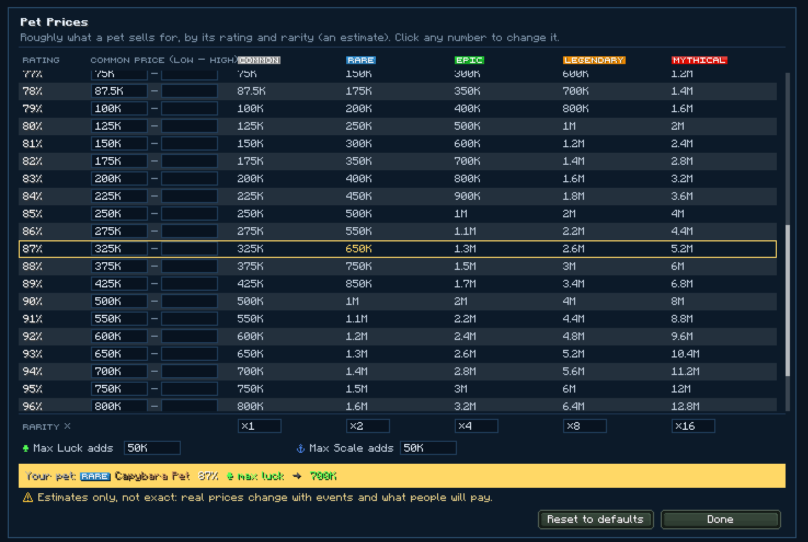</p>

Press **`U`** (or **O → Tools → Pet Prices**) for a price sheet of what a pet sells for, by its rating and rarity.
- **The sheet:** two bands below 60%, then every percent from 60% to 100%, each with a Common price (a single price or a low–high range) and the price for every rarity beside it.
- **Rarities:** ×2 Rare, ×4 Epic, ×8 Legendary and ×16 Mythical by default; change any multiplier.
- **Max Luck / Max Scale:** each adds 50K by default, when the pet's rolls are at their best.
- **Edit anything:** click any number to change it. It's saved for you, and **Reset to defaults** puts the starting prices back.
- **Your pet:** your equipped pet's row is highlighted, with its price in the bar at the bottom.
- **Used everywhere:** the same prices show at the top right of every pet's tooltip and in the trade value boxes. A pet is priced at the rating its tooltip shows (an 82.6% pet is priced as 83%).
- **Estimates only:** real prices change with events and what people will pay.

---

## Rod parts

<p align="center"></p>

- **Calibration icons:** a small icon in the bottom-right corner of a rod part for what it's calibrated for: XP, money, luck, scale, prospect, albino, melanistic, trophy or bite/reel speed.
- **On the rod too:** a rod shows an icon for each stat its line, pole and reel are calibrated for, stacked up the right side.
- **Max rolls in purple:** an icon turns all purple when that stat is rolled at the highest its rarity can roll. On a rod, a stat on two parts with only one of them maxed is half purple, half its own colour.

---

## Dry streaks & stats

- **Stats tab:** an **S** tab on the right of your inventory opens every all-time stat and dry streak, in the FOE+ or FOE-R look. It stays open until you click the tab again.
- **Live dry streaks** for every rarity, variant, Gigantic, pets, shards, Infusion Capsules and Lightning Bottles, shown on the All-Time Stats panel. Like FOE, the capsule streak only counts Blood Moon catches and the bottle streak only thunderstorm catches, since that's when they drop. The Fabled streak only counts while a Fabled event is on, and ends as soon as the Fabled is caught.
- **Import previous FOE/FOE-R stats:** one button in **O → Stats** (FOE if it's found, otherwise FOE-R; Shift-click to pick the folder).
- **Import from old installs:** FOE+ finds previous FOE and FOE-R installs (Prism, Modrinth, CurseForge, `.minecraft` and other profiles) and imports your stats on first launch.
- **Import Dry Streaks:** pulls streaks (including pets, shards, Infusion Capsules and Lightning Bottles) from your newest old FOE or FOE-R install, plus your pet, shard, capsule and bottle totals where they're higher there. A streak you've reset since then is never overwritten by an older, higher one.
- **Edit Dry Streaks:** set any streak by hand (rarities, variants, Gigantic, pets, shards, Infusion Capsules and Lightning Bottles). Manual edits count as newest, so an import won't undo them.
- **Edit All-Time Stats:** fix any total by hand (fish caught, pets, shards, Infusion Capsules, Lightning Bottles, quests, rarities, variants and Gigantic). Dry streaks stay as they are.
- **Import FOE-R stats:** finds your FOE-R install on its own (Modrinth, CurseForge, Prism, PolyMC, MultiMC, ATLauncher, GDLauncher, the official launcher and TLauncher, on Windows, macOS and Linux, including a Prism instance folder you moved) and uses its stats if it has more fish, after backing yours up. Not found? It opens a folder window to pick the install yourself (Shift-click the button to go straight there).
- **Reset Fish Timer:** start fish per hour from zero (Fish Time follows the server's "Time Fishing").

---

## Contests

- The top 3 always show, plus your own rank and best catch.
- The fish the contest wants is shown in brackets next to the contest type.
- Levels are coloured like the game's own level brackets.
- The panel updates as soon as the server posts a new personal best (`CONTESTS » 26.85lb → 27.45lb`).
- It also refreshes when you change area, and tells you when you're outside the contest area.

---

## Travel map

<p align="center"></p>

The server's Locations menu (`/tt`, or the travel NPC) opens as a detailed world map.

- **Every location on the map:** each one sits on its own landmark, with its name in the server's colours. The place you are at has a gold frame.
- **Same clicks as the menu:** hover for the server's own tooltip, left-click to teleport, right-click to view species.
- **Two maps:** **Realistic** (built from the places themselves, shown above) or **Fantasy** (the painted map). **Change view** switches between them and the server's plain menu any time; "Back to travel map" above that menu returns. Turn the map off altogether with **O → Travel map**.
- **Favourites:** star one teleport spot in each place.
- **What's on:** a Fabled fish waiting to be caught, a Fish Frenzy and its time left, the place's own event, or the mini event (in pink), right on its place. Two at once split the square's border half and half (a Fabled or a frenzy comes first).
- **Contests:** a small gold trophy at the end of the place's name a contest is at, with its type and time left in the tooltip.

## Fishing presets

<p align="center">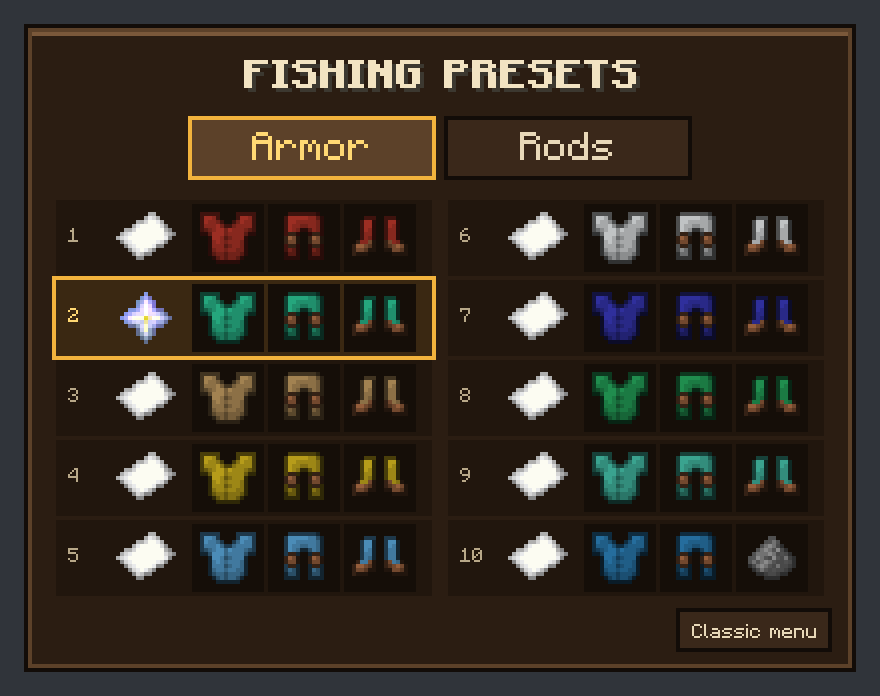</p>

The server's Presets menu on one screen, without paging.

- **All ten at once:** presets 1–5 on the left and 6–10 on the right, with **Armor** and **Rods** tabs at the top.
- **Wear a preset:** click its tick. The preset in use shows the star and a gold frame; clicking the star takes it off.
- **Change a piece:** click a piece to send it back to your inventory. To put one in, pick it up from your inventory (which stays below the panel) and click a place in the preset.
- **Tooltips:** hovering a piece shows the server's full tooltip.
- **Three styles:** clean rows, cards with the pieces on a tray, or lighter slots with a round marker, picked from the **Style** menu on the panel.
- **Classic menu:** a small button on the panel switches to the server's plain menu; "FOE+ presets view" above that menu returns. Turn the panel off with **O → Presets screen**.

## Personal Vault & bait

<p align="center"></p>

- **Bait sorter (`B`):** merges and sorts the baits and lures (mythical ones too; lures match by what they are: name, rarity, colour, size, intricacy and water, however the server wrote them; if the server won't take a merge, the lure goes back where it was) in your inventory, chests and vault, by rarity, amount or name. Every copy of a bait on a vault page merges through the one in your inventory and goes back, and twins that are only in the vault are pulled out to merge. It remembers the order you last picked on the vault's sort buttons.
- **Save Layout:** arrange a vault page the way you like and press **Save Layout**: from then on `B` puts every item on that page back in the slot you saved it in, until you use one of the sort buttons. Each page has its own; Shift-click to forget it.
- **Personal Vault:** page buttons 1–7, a **Bait Sorter** box (sort baits by amount, rarity or name; name groups every Crankbait together), an **Armor Sorter** box (by quality, rarity, climate or rolls) and a **Pet Sorter** box (by percent, luck, scale, rarity or name). Everything else stays put, Shift-click reverses, the boxes are on chests too, and locked pages show their rank badge.
- **Bait Prices (Tools → Bait Prices):** what a bait is worth to you: a price for each rarity, and your own price for any single bait. Every bait and lure from the wiki's Tacklebox list is there with its rarity and picture. **Packs** lists the bait packs (Standard, Advanced and each location's, every rarity, with their pictures) for your own price, as they have no set price yet.
- **Bait value:** a baitbox's Package (or any menu with bait) gets a box with what its bait is worth; a bait's Stock line shows the stack's value; and opening a baitbox puts the total in chat.
- **Fish value:** beside a chest, what the fish in it and in your inventory are worth.

## Tools

<p align="center">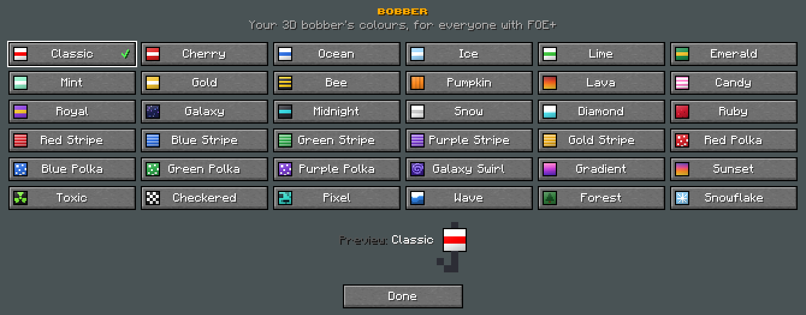</p>

- **Trade value:** on a trade, a box beside each side of the menu adds up what it puts in: fish at their sell value, bait and lures at your bait prices, pets at your pet prices, money offered, and how many other things; under theirs, what you gain or lose by it. Estimates from your own prices; can be turned off in Inventory settings.
- **Auto Tip (`M`):** automatically tips reaction winners and chummers, with per-tip amounts, rarity badges and a session total. One `[FOE+] AUTO TIP` line per tip (the server's matching PAY line is hidden).
- **Private messages:** what you type after `/msg <name>` (or `/r`) is in the server's message green.
- **Inventory search:** the Personal Vault's search bar above your inventory and in chests too; matching items get a red outline (the search help shows only on the vault's bar), and while you type, keys like Q and 1–9 don't drop or swap items.
- **Inspect:** hold Shift to see fish details, pet % and armor rolls, or set Inspect to **Always On**, **Pets Only** or **Armor Only** in the O menu.
- **Friends:** `/foe friend` (or **O → Social → Friends**) opens your friends in one window: add someone by name (online players come up as you type), see each friend's balance and crew on their card, and **Join instance** takes you to theirs. `/foe friend add <name>`, `remove` and `list` work too. Friends show on the Social panel in blue; a friend who is also in your crew is light blue with an orange ★ (the crew colour).
- **Chat tags:** Tab completes the server's chat tags ("[it" → "[item]").
- **Crew and friend alerts:** a chat line when a crew member or friend comes online or goes offline.
- **Inventory warning box:** the inventory almost full warning can go in a box of its own (**HUD settings → Inventory Warning Box**), to move anywhere, away from the wrong gear warnings. Off to start: it's a line in the Wrong Gear box.
- **Dismiss warnings (`-`):** hides the warning box everywhere until you press it again (or turn "Warning box hidden" off); the box's last line says which key does it. The place in its lines shows in its own colour.
- **Bobber timer:** how long your bobber has been out ("12.4s") floating over your own bobber; it hides once a fish is on. On by default (from FOE's bobber tracker).
- **Bobber presets:** 36 colour sets for the 3D bobber (Classic, Cherry, Ocean, Ice, Lime, Emerald, Mint, Gold, Bee, Pumpkin, Lava, Candy, Royal, Galaxy, Midnight, Snow, Diamond, Ruby, stripes, polka dots, Galaxy Swirl, Gradient, Sunset, Toxic, Checkered, Pixel, Wave, Forest and Snowflake), with sharp textures and a real preview, picked in **O → Bobber**. Other FOE+ users near you see your preset, and you see theirs. Players without FOE+ stay Classic.
- **Short rarity badges (O → HUD → HUD Settings):** the rarity badges in the HUDs (Quests, All-Time Stats, Session Stats and the rest) as short ones, the first letter on the badge's colour: C, R, E, L, M, G for gigantic, and A, M, T, F for Albino, Melanistic, Trophy and Fabled. **Short badges in chat** does the same for every line in chat, players' rank badges (ANGLER, STAFF...) included.

<p align="center">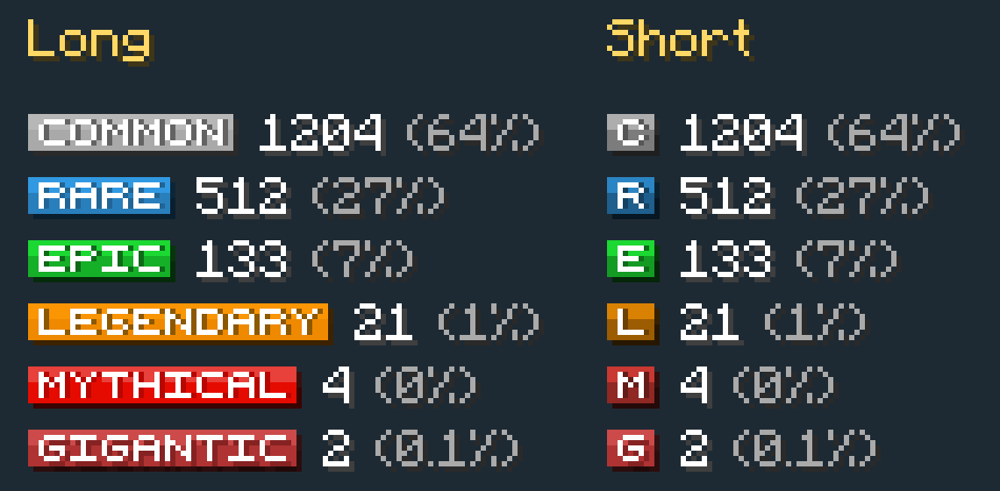</p>

- **Wiki (O → Tools):** the FishOnMC wiki in its own panel, in game: every page and picture is a copy inside FOE+ (brought up to date with each release), so it works without going online, and FOE+ lays them out itself (headings, text, colours, lists, tables, pictures), so nothing opens in your web browser. Links go to their page (or their part of it), ← and → (or the mouse's side buttons, or Backspace) go back and forward, ⌂ goes to the start page, and the search box searches the whole wiki. Click a picture to see it big. A link that leaves the wiki is copied for you instead.

<p align="center">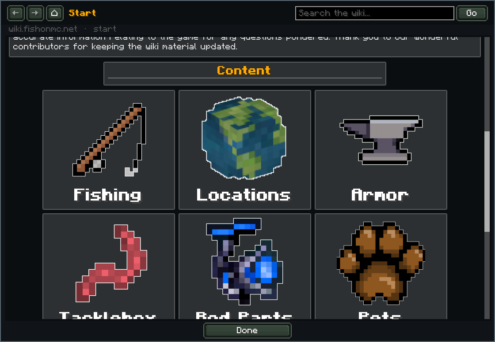<br>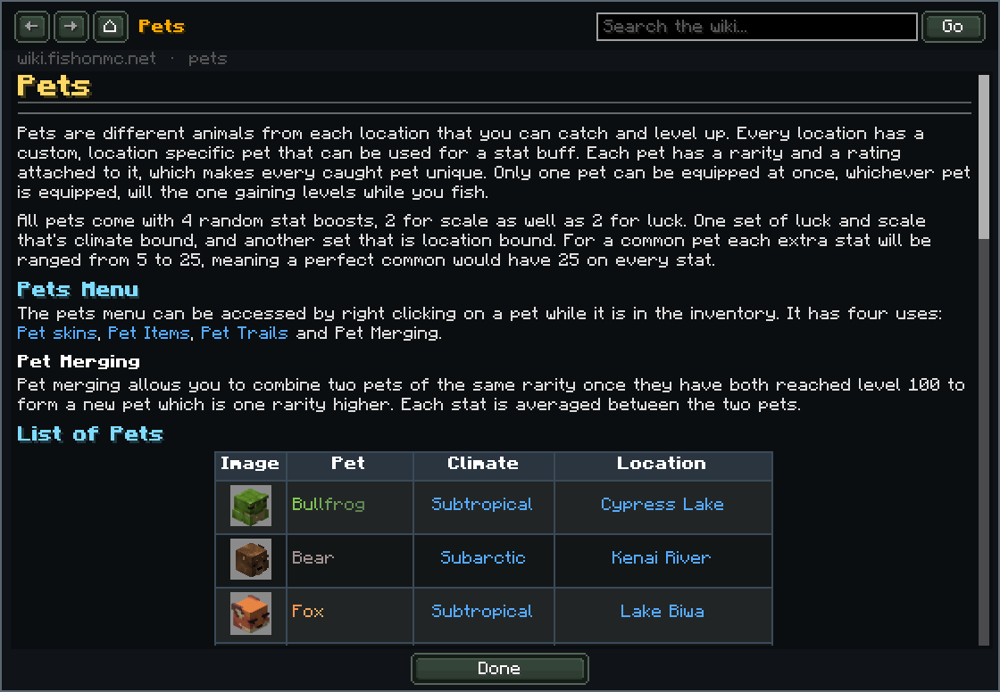</p>

- **Bait Abuse (O → Tools):** the best baits at every place for each goal (Rare, Epic, Legendary, pet leveling), best first, with when they count (1k+ Luck, a booster) and which are tied, from the community's Bait Abuser Central sheet. Pick a place along the top or search by bait, place, goal or condition. Turn on **Edit** to change any line, add baits, goals or places, or take any away; it's saved on your computer, and **Reset** brings back FOE+'s list.

<p align="center">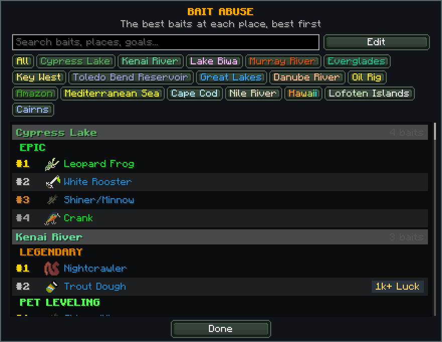</p>

- **Bobber shape:** Classic (the block bobber) or **Round** (a round float, like a real one), with the Shape button in **O → Bobber**. Every preset works on both: its stripes, bands and dots wrap round the ball. Other FOE+ users near you see your shape, and you see theirs (with "Show other FOE+ users' bobber styles" on); players without FOE+ stay the block.

<p align="center">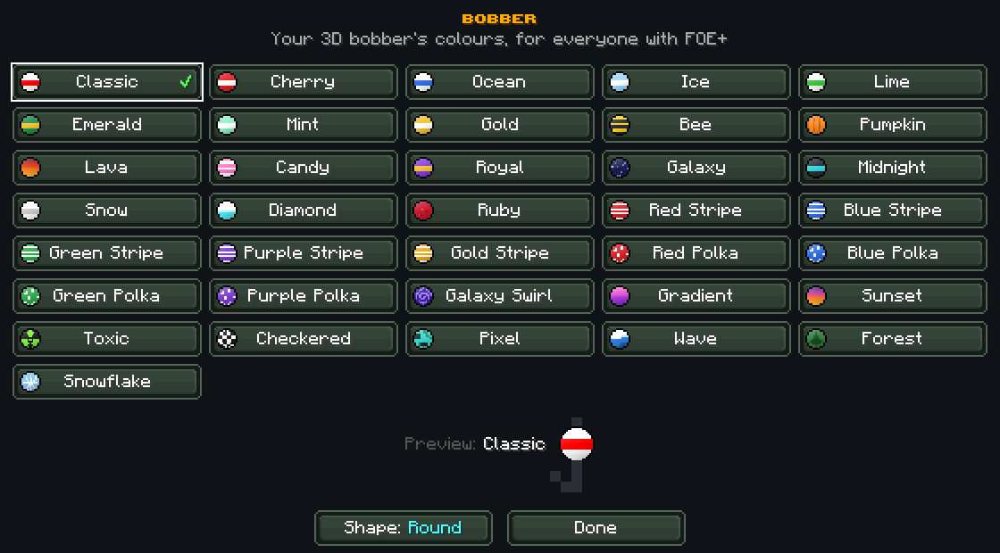</p>

- **FOE+ users:** a **+** (with a 1-pixel gap so it never touches) after the name of nearby players who use FOE+, in the colour they pick in the O menu (16 colours, or any colour on the colour wheel; players on an older FOE+ see the nearest of the 16). Optionally the FOE+ icon above their heads, and the + in the tab list.
- **Hide offline friends:** one button in **O → Social** hides offline crew and friends on the Social panel and next to your inventory.
- **Chat tags:** the server's tags are small boxes (Social Media is a yellow **M**).
- **Big catch moment:** catch a Fabled, Trophy, Gigantic, Albino or Melanistic fish (or Mythical and Legendary, if you turn them on) and a soft glow in its colour fades in and out at the edges of your screen. Each kind, the glow, its strength and length can be set in **HUD settings → Big Catch Moment**. Big catches have their own sounds too, on by default and set in **Sounds → Catches**: a conduit for Fabled, a bell chord for Trophy, a level up for Mythical, an amethyst chime for Gigantic and a soft chime for Albino and Melanistic. A variant's sound plays the moment that variant bites *your* line (its badge at your bobber, as the variant pulse sees it), and only then; Mythical and Gigantic play when you catch one. One sound per fish. From [tacklebox](https://github.com/landofif/tacklebox) by landofif, used with permission.
- **Water rings:** a ring on the water in the fish's rarity colour when you catch it (with sparkles for legendary, mythical and special); turn on rings at your bobber that come quicker as a fish swims in (a bigger one on the bite) and a wake behind your fish if you like. Each part, strength, size and thickness are in **Renderer → Water Rings**. From [tacklebox](https://github.com/landofif/tacklebox) by landofif, used with permission.
- **Variant pulse:** the moment an albino, melanistic, trophy or fabled fish bites *your* line (the server's badge over your bobber), the screen's edges pulse in its colour (white, black, gold, red) until it's caught. Someone else's variant next to you never sets it off. Each variant has its own switch, all on to start (**HUD settings → Variant Pulse**).
- **HUD decorations:** little pictures on a HUD's corners (a heart, a sleeping fox, a cat tree, flower pots, vines, the FOE+ sign, and FOE+'s own: snow, a star, a mushroom, a bobber in the water, a fish, a pumpkin...), each corner picked on its own in the HUD Editor's **Decor** tab. From FOECollab's flair.
- **FOE+ sounds:** 42 sounds made from scratch for FOE+ come with it (all original, built in code by `tools/foe_sounds.py`: no recordings or borrowed tunes), under "FOE+ sounds" at the top of every sound picker (Coin Pickup, 1-Up Chime, Victory Fanfare, Rare Drop, Jackpot Spin, Sea Beast Roar, Wah Wah Fail and more), and searchable by name.
- **Your own sounds:** put .ogg files in the folder the Sounds menu's **Your sound files…** button opens and they show under "Your sound files" with clean names, ready for any FOE+ sound.
- **Amulet stars:** a colour for the equipped-pet star of each amulet (**O → Amulet Stars**), every amulet listed with its picture: Wade's, Midas, Onyx, Ivory, Fabled, Bigfoot's Necklace, Bigfoot's Amulet, Moon, Cryptid, Titan's Graceful Necklace and Prospecting.

<p align="center">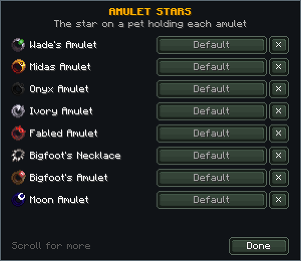</p>

- **Event teleport:** under a chat line about an event starting at a place (a Fish Frenzy, the Fabled fish, a mini event), and on FOE+'s own line when a cryptid comes out (Garaboncias with the rainbow, Bigfoot, Titanoboa, Bessie, Rougarou), a **[Teleport]** button takes you there: to your favourite spot (★ on the travel map), or its first spot. The travel menus it goes through are never shown, so nothing flashes up.
- **Teleporting from your crew island:** the server lands you at spawn whatever you picked; FOE+ remembers where you were going (from the travel map or a [Teleport] button) and takes you on there.
- **Each HUD Style keeps its layout:** switching between FOE+ and FOE-R puts your HUDs back where you had them in that style.
- **Fishing line colour:** your own fishing line in any colour, picked in **O → Line** next to the bobbers.
- **Pet equip star:** the star on your equipped pet in any colour (the Bigfoot amulet's is pink).
- **Values in chat:** hover a bait or a pet in chat to see what it's worth (a pet's price from your Pet Prices sheet, by its rarity, rating and Max Luck / Max Scale, at the end of its name's line); bait tooltips show the price of each bait under the total. The bait's or pet's tooltip shows only when you're on its name ("1x Suspending Jerkbait"), not anywhere on the message; elsewhere on it you see only when it was sent.
- **Safety net:** if the server changes how something looks, the FOE+ part that reads it is skipped instead of crashing your game.

---

## Sounds

<p align="center">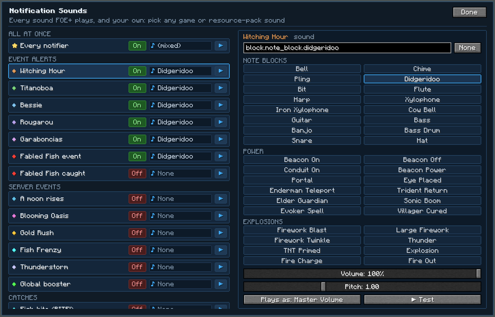</p>

**O → Tools → Sounds** lists every sound FOE+ plays: event alerts, server events, catches (including **Fish bite**, when BITE! pops up), the daily quest warning ("About to complete daily quest") and more. Turn each one on or off, pick any game or resource-pack sound, and set its volume and pitch.
- **Fish bite** replaces the server's own bite sound while it's on: the server's never plays, even though it comes before the BITE! title, and yours plays the moment it would have (FOE+ learns which one it is over your first few bites and remembers it).
- **Shard caught:** your sound plays the moment a shard's chat line comes (only for a shard), and the server's own shard sound is muted while yours is on (FOE+ picks it out from your shards, never taking a sound that plays with ordinary fish).
- **Infusion Capsule, Lightning Bottle and Prospecting Amulet** each have their own sound.
- **Event endings:** a sound when each event ends (Witching Hour, the cryptids, the Fabled event, the moon, Blooming Oasis, Gold Rush, Fish Frenzy, thunderstorms, global boosters), all off to start.

**Your own triggers** (like ChatNotify):
- **Match:** up to four triggers and three exceptions, each Contains, Whole word, Starts with, Regex or a translation key; case sensitive or not, and skip your own messages.
- **Sound:** any sound, volume, pitch, and a cooldown so it doesn't spam.
- **Also:** colour the matched words (any colour, on the colour wheel), make them bold or underlined, show a title on screen, and flash the game in your taskbar.

---

## Keybinds

| Key | Action |
|---|---|
| `O` | Open the FOE+ menu |
| `M` | Auto Tip |
| `U` | Pet Prices |
| `B` | Sort baits |
| `-` | Hide or show the warning box |
| *(not set)* | Open the Presets menu |
| *(not set)* | Open the Quests menu |
| `Left Shift` | Inspect (hold) |

All keys can be changed in **O → Settings**.

---

## From FOE-R

FOE+ keeps everything from FishonMC-Extras-R. Find it under **O → More (FOE-R)**:

- Profile, location and notifier HUDs (caught fish and items, completed quests, full inventory)
- Sidebar quests and the hotbar HUD (armor, rod parts, bait)
- Rarity markers on items and a smaller stack counter (it also counts baits)
- A full real-time stats tracker that can import from your server profile
- A 3D fish bobber model
- Triggers, timers, notifications and chat snippets

---

<sub>FOE+ is built on [FishonMC-Extras-R](https://github.com/FishOnExtras/FishonMC-Extras-R), with features from [FOECollab](https://github.com/Kimberlyow/FOECollab) and [FishOnAutotip](https://github.com/Kimberlyow/FishOnAutotip). Licensed under the AGPL-3.0. Not affiliated with Mojang, Microsoft or the FishOnMC server.</sub>
