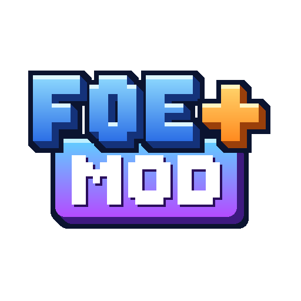
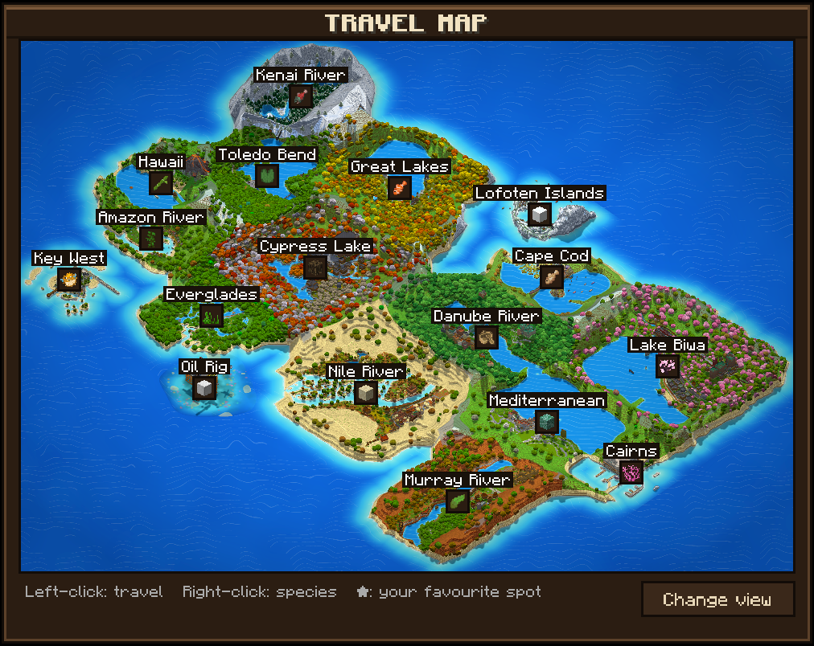
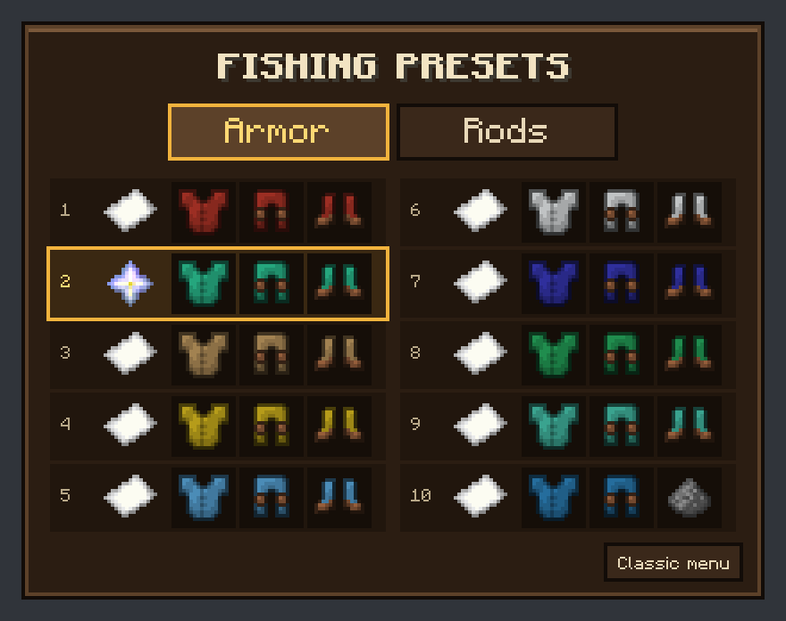
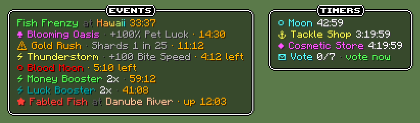
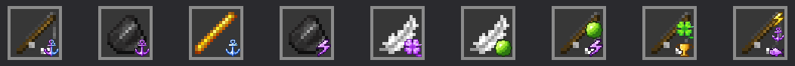

<p align="center"></p>

# FOE+

FOE+ is a quality-of-life mod for **play.fishonmc.net** (Fabric, Minecraft 1.21.11).
It is built on [FishonMC-Extras-R](https://github.com/FishOnExtras/FishonMC-Extras-R) (FOE-R) and brings in the features of
[FOECollab](https://github.com/Kimberlyow/FOECollab) (FOE) and [FishOnAutotip](https://github.com/Kimberlyow/FishOnAutotip),
plus new features of its own.

Press **O** in game to open the FOE+ menu.

**[See the full feature list →](FEATURES.md)**

## Features

**Travel map and presets** (new screens over the server's own menus)
- Travel map: `/tt` opens a detailed world map with every location on it. Hover for the server's tooltip, left-click to teleport, right-click to view species. Pick the **Realistic** map (built from the places themselves), the **Fantasy** painted map or the server's menu with **Change view**; star a favourite spot in each place; Fabled fish and Fish Frenzies show on their place.
- Fishing presets: all ten armor presets (or all ten rod presets) on one screen, with no page arrows. Click a tick to wear a preset, click a piece to take it out; the one in use has a gold frame.
- Presets come in three styles (clean rows, cards on a tray, lighter slots), picked from the **Style** menu on the panel.
- Both have a **Classic menu** button to get the server's plain menu back, and a setting to turn them off.

<p align="center">
  <br>
  
</p>

**HUD panels** (move, anchor and resize them in *O → Move HUD Elements*; they never leave the screen or cover each other)
- Contest: timer, type, the fish you need (in its rarity colour), best baits from a bait sheet (as pictures or names, hover for the rest), top 3 and your rank. Updates every minute, on a new personal best and when you change area.
- Daily Quests: exact progress after every catch.
- All-Time Stats: fish, fish/hour, fish time, rarities, Gigantic and variants with dry streaks.
- Quests, Pet (with held item, XP bar and a **Max Luck / Max Scale** tag), Bait, Luck & Scale (read from your /menu profile, boosters included).
- Events: Fish Frenzy, Blooming Oasis, Gold Rush, Fabled, boosters, and the weather (rain showers, thunderstorms, supercells, moons) with how long they have left.
- Timers (moon, Tackle Shop, Cosmetic Store, votes, community goal with catches per hour) and Social (crew and friends online, with the instance they're on).
- **HUD Editor:** change any panel's line spacing, padding, colours, text alignment, or put your own PNG/GIF in it. Two HUD looks: FOE+ or FOE-R.
- Alerts: Witching Hour, Titanoboa, Rougarou, Garaboncias, Bessie and Fabled events, with timers.
- Warning box: wrong pet for the location (names the right one), wrong armor climate, inventory almost full. Hide it with `-` until you move.
- Top bar (level in your chat colours, location in the travel menu's colours, spot, weather, time, balance, credits, catches, TPS & ping; every part can be turned off), equipment bar, catch popup, catch ring, moon timer (inventory screen).

<p align="center">
  <br>
  
</p>

**Chat**
- Clean `[FOE+]` lines for pets, variants, Gigantic catches, alerts, Fabled catches, wrong pet, contest best and tips.
- Contest auto-refresh output is hidden; contest messages get proper spacing.

**Tools**
- Bait sorter (`B`): merges every copy of a bait or lure (mythical too) between your inventory and the vault, then sorts. **Save Layout** in the vault: arrange a page your way and `B` puts everything back there.
- Personal Vault and chests: page buttons, Bait, Armor and Pet Sorter boxes, and what the fish (or bait) inside are worth.
- Bait Prices: your own price for each rarity and any single bait; baitbox totals and stack values use it.
- Rod part icons: a small icon for what each rod part (or each part of a rod) is calibrated for, purple when it's rolled at its max.
- Auto Tip (`M`): tip reaction winners and chummers automatically.
- Pet Prices (`U`): price table from a Google Sheet (updated once a day).
- Inspect always-on toggle, rating letter and max luck/scale markers on pets.
- `+` (or the FOE+ icon) after the names of nearby FOE+ users, and in the tab list.
- Friends (`/foe friend` or O → Social): add friends, see their balance and crew, join their instance.

**Stats**
- Import stats from previous FOE / FOE-R installs (other profiles too), import dry streaks (newer streaks are never overwritten), edit dry streaks by hand.

## Building

Requires Java 21.

```
./gradlew build
```

The mod jar is written to `build/libs/`.

## Credits

- **FishonMC-Extras-R** by DannyPX and contributors (GPL-3.0): the base of this mod.
- **FOECollab** by Kimberlyow and contributors (AGPL-3.0): many features were ported; see [CREDITS-FOECollab.md](CREDITS-FOECollab.md) for the list.
- **landofif (dofi)** (Minecraft: merryfish): the bait sorter (`BaitSorterHandler`, `SortPlanner`), written for FOECollab ([#10](https://github.com/Kimberlyow/FOECollab/pull/10), [#11](https://github.com/Kimberlyow/FOECollab/pull/11)) and ported to FOE+.
- **FishOnAutotip** by Kimberlyow (GPL-3.0): Auto Tip.

## License

FOE+ contains code under the GNU GPL-3.0 (from FOE-R and FishOnAutotip) and the GNU AGPL-3.0 (from FOECollab).
GPL-3.0 section 13 allows combining them; the combined work is distributed under the terms of the
**GNU Affero General Public License v3.0** ([LICENSE-AGPL-3.0](LICENSE-AGPL-3.0)), and FOE-R's original GPL-3.0 [LICENSE](LICENSE) file is kept.

**Disclaimer:** Not affiliated with Mojang, Microsoft or the FishOnMC server. This is a player-made mod.
